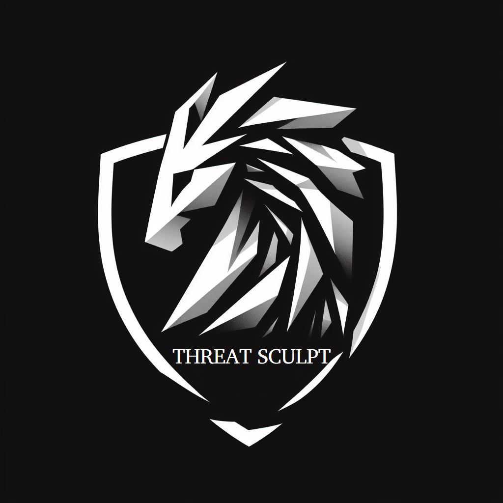

# ThreatSculpt

**Vulnerability scanning that reports in the language of the business.**

Every scanner on the market produces the same artifact: a list of CVEs sorted by CVSS. That
list is unreadable to the person who approves the remediation budget. ThreatSculpt closes that
gap — it maps discovered vulnerabilities onto the business services they threaten and ranks
them by what they actually put at risk, so the output of a scan is a decision an executive can
make rather than a spreadsheet they forward to someone else.

> **Status:** v2 is a ground-up rewrite on the `rewrite/v2` branch. The v1 code on `main` was a
> university capstone and is archived, not maintained. See [Migrating from v1](#migrating-from-v1).

## How it works

A lightweight **scan agent** runs inside the customer's network and talks outbound-only to the
hosted **control plane**. Nothing needs to be exposed to the internet, and no inbound firewall
rule is required.

```
 Customer network                        ThreatSculpt cloud
 ┌──────────────────┐   HTTPS/443 out   ┌────────────────────────┐
 │  scan-agent      │ ────────────────► │  control-plane (API)   │
 │  nmap + parser   │                   │  scoring · enrichment  │──► PostgreSQL
 └──────────────────┘                   │  reports               │
                                        └───────────┬────────────┘
 ┌──────────────────┐        HTTPS                  │
 │  web dashboard   │ ──────────────────────────────┘
 └──────────────────┘
```

The agent reports only **what is running** — hosts, ports, services, versions, CPEs. CVE
matching, exploit-maturity lookup, and risk scoring all happen server-side. That keeps the
agent's only internet dependency the control plane itself, and means historical scans get
better as the vulnerability mirror updates, without rescanning anything.

## The scoring model

```
business_risk = cvss_base
              × exploit_maturity     (CISA KEV listed / weaponized / PoC / none)
              × exposure             (internet-facing / DMZ / internal / isolated)
              × asset_criticality    (from the business service the asset supports)
```

Every factor is stored with the finding, so the dashboard and the generated report can show
*why* something ranks where it does. A number nobody can interrogate does not change anybody's
mind — the explanation is the product, not a nicety.

## Repository layout

| Path | What it is |
|---|---|
| `apps/control-plane/` | FastAPI service — API, tenancy, enrichment, scoring, reports |
| `apps/scan-agent/` | On-prem daemon — job poller, nmap runner, result submitter |
| `apps/web/` | React + TypeScript dashboard |
| `deploy/` | Docker Compose for local development, agent packaging |
| `docs/` | Architecture, data model, agent protocol, API contract |

## Documentation

| Document | Read it for |
|---|---|
| [Architecture](docs/ARCHITECTURE.md) | System design, tenancy model, and the reasoning behind each choice |
| [Data model](docs/DATA-MODEL.md) | Full PostgreSQL schema |
| [Agent protocol](docs/AGENT-PROTOCOL.md) | The agent ↔ control-plane contract |
| [API contract](docs/API.md) | Dashboard REST API |
| [Security](SECURITY.md) | Security posture and vulnerability reporting |

## Security posture

Three properties are load-bearing, and each is enforced structurally rather than by convention:

**Tenant isolation.** Every tenant table carries `org_id` with a foreign key, every query goes
through a scope object that injects the predicate, and PostgreSQL Row-Level Security backstops
both. No endpoint accepts a tenant identifier from the caller — the org is derived from the
authenticated principal, always.

**Scan authorization.** A scan is an instruction to send packets at a network, so both ends
validate. The control plane refuses targets outside a network the org has registered *and*
marked authorized. The agent independently re-validates against its own local config before
invoking nmap, and the server can only ever narrow that local allowlist. A compromised control
plane therefore cannot turn a customer's agent into a scanner-for-hire.

**Credential separation.** Users and agents are different principal types with different
credentials and separate authentication dependency chains. An agent key cannot reach the
dashboard API; a user token cannot claim scan jobs.

## Migrating from v1

There is no migration path, and that is deliberate. v1 stored passwords in plaintext in one
code path and bcrypt in another against the same collection, had no session mechanism, and
returned any user's scan data to any caller who supplied their `userID`. Its data cannot be
imported without importing those defects.

**If you ever deployed v1:** its MongoDB Atlas credentials and its Vulners and Pulsedive API
keys were committed to this public repository. Revoke all three. Rescan with v2 rather than
importing v1 data.

## License

MIT — see [LICENSE](LICENSE).
